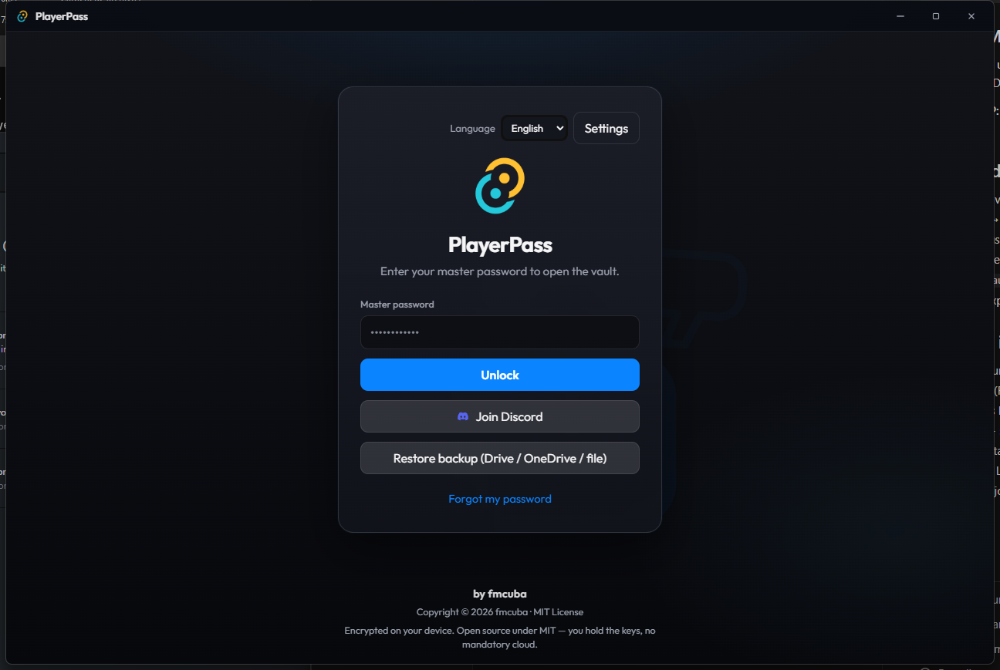

# PlayerPass

Local game-account manager: one place to store them encrypted and copy username/password with a click.



## Download

Install the latest Windows NSIS setup from GitHub Releases:

**[Download PlayerPass for Windows](https://github.com/FamiliaCuba/PlayerPass/releases/latest)**

Direct asset (after the Release workflow finishes):  
`PlayerPass_0.1.0_x64-setup.exe` → [latest release assets](https://github.com/FamiliaCuba/PlayerPass/releases/latest)

## Features

- On-disk encrypted vault (Argon2id + AES-256-GCM)
- Master password on launch
- Idle auto-lock (configurable)
- Automatic clipboard clear (configurable; only if content is still from PlayerPass)
- Favorites, trash with full empty, light/dark theme
- Platforms with icons (Steam, Xbox, Battle.net, EA, Epic, etc.)
- Popular games catalog (CoD, Warzone, Battlefield, etc.)
- Copy username, password, or `username:password`
- Local / Drive / OneDrive backup (optional OAuth)
- Admin-assisted recovery (code + Discord notify in private builds)
- Auto-update from GitHub Releases (requires updater keys + public repo)
- Modern desktop-style UI

## Requirements

- Node.js 20+
- Rust (stable)
- On Windows: Visual Studio Build Tools (C++) / Desktop development with C++
- WebView2 (included with recent Windows 10/11)

## Windows install — SmartScreen notice

1. Download the NSIS installer from Releases: `PlayerPass_x.y.z_x64-setup.exe`.
2. When you open it, **Windows SmartScreen** may say “Windows protected your PC”.
3. Click **More info** → **Run anyway**.
4. Finish the installer (current-user mode).

**Why SmartScreen appears:** without a trusted code-signing certificate (Authenticode), Windows treats the `.exe` as unknown. That is normal for indie / open-source software without a paid certificate.

**Recommendation:** sign the installer with an Authenticode certificate (see [Code signing](#code-signing-windows)). Until then, the warning will keep appearing.

If you have a support/community Discord, configure the invite in `src-tauri/secrets/local.rs` (`DISCORD_INVITE_URL`); it shows up in the app.

## Development

```bash
# Local secrets (required for recovery/Discord in release builds)
cp src-tauri/secrets/local.example.rs src-tauri/secrets/local.rs
# Edit local.rs with your webhook and admin code (never commit it)

npm install
npm run tauri dev
```

## Build (Windows)

```bash
npm install
# In PowerShell with the MSVC environment (vcvars64) if needed:
npm run tauri build
```

Typical outputs:

- `src-tauri/target/release/bundle/nsis/PlayerPass_0.1.0_x64-setup.exe` ← **use this installer**
- `src-tauri/target/release/playerpass.exe`

## Code signing (Windows)

Without a certificate, SmartScreen will keep warning. When you have a `.pfx` or a certificate in the Windows store:

### Option A — thumbprint in Tauri

In `src-tauri/tauri.conf.json` → `bundle.windows`:

- `certificateThumbprint`: SHA1 thumbprint of the certificate (hex string, no spaces)
- `digestAlgorithm`: `"sha256"`
- `timestampUrl`: e.g. `"http://timestamp.digicert.com"`

Then `npm run tauri build` will sign the NSIS bundle.

### Option B — signtool + `.pfx` file

```powershell
# Example (adjust paths and password)
signtool sign /f "C:\certs\playerpass.pfx" /p "%CERT_PASSWORD%" /fd sha256 /tr http://timestamp.digicert.com /td sha256 `
  "src-tauri\target\release\bundle\nsis\PlayerPass_0.1.0_x64-setup.exe"
```

Common CI env vars: `WINDOWS_CERTIFICATE` (base64 of the `.pfx`), `WINDOWS_CERTIFICATE_PASSWORD`.

**Without an end-user certificate you cannot truly sign** — the config is ready; only the cert is missing.

## Auto-update (GitHub Releases)

PlayerPass uses `tauri-plugin-updater` + `tauri-plugin-process` (relaunch).

**Full guide (keys, CI, tag `v0.1.0`, checklist):** [docs/RELEASE.md](docs/RELEASE.md).

Summary:

1. Generate keys: `npm run tauri signer generate -- -w ~/.tauri/playerpass.key` → pubkey in `tauri.conf.json`, private key in GitHub secret `TAURI_SIGNING_PRIVATE_KEY`.
2. Endpoint: `https://github.com/FamiliaCuba/PlayerPass/releases/latest/download/latest.json`
3. `bundle.createUpdaterArtifacts`: `false` in the repo (local build without private key); the CI workflow flips it to `true` only in the release job.
4. Publish: bump version in 3 places → tag `vX.Y.Z` → push the tag → Actions + GitHub Release (`setup.exe` + `latest.json`).
5. The app checks for updates on startup and from **Settings → Check for updates**.

Without private key / pubkey / a public release, the check fails safely (vault stays intact).

### End-to-end update test

With only `v0.1.0` published, an installed `0.1.0` build will **not** see an update (same version). To verify client auto-update for real:

1. Install `v0.1.0` from Releases.
2. Bump to `0.1.1` in `package.json`, `src-tauri/tauri.conf.json`, and `src-tauri/Cargo.toml`.
3. Tag and push `v0.1.1` → wait for Actions.
4. Open the installed app → startup check or **Settings → Check for updates**.

Until that bump, a green Release pipeline means **artifacts + signing + `latest.json` are published**; it does not prove the installed client applied an update.

## Secrets (do not commit)

`src-tauri/secrets/local.rs` is in `.gitignore`. It holds:

- `DISCORD_WEBHOOK_URL` — embedded into the `.exe` at compile time
- `ADMIN_RECOVERY_CODE` — internal recovery secret for the build
- `DISCORD_INVITE_URL`
- `GOOGLE_OAUTH_CLIENT_ID` / `MICROSOFT_OAUTH_CLIENT_ID` — Drive/OneDrive backups

### OAuth (Google Drive + OneDrive)

Use the same redirect URI in both consoles:

`http://127.0.0.1:17855/oauth/callback`

1. **Google:** Google Cloud Console → APIs → enable Google Drive API → Credentials → OAuth client ID (**Desktop app**) → paste the Client ID into `local.rs`.
2. **Microsoft:** Azure Portal → App registrations → New → Accounts in any org + personal → Authentication → Mobile and desktop → add the redirect → Application (client) ID in `local.rs`. Public client (no secret). Graph permission: `Files.ReadWrite.AppFolder` + `offline_access`.

In the app: **Backup** (vault unlocked) or **Restore backup** (login). The `.playerpass` file stays encrypted with the master password.

## Security

- Vault: Argon2id + AES-256-GCM (local data).
- Auto-lock after N minutes of inactivity (default 10; adjustable in Settings).
- Clipboard: cleared after N seconds (default 25) only if the text is still what was copied.
- Recovery: one-time OTP via Discord only (never returned to the frontend); rate limiting on unlock/recovery.
- The new master password is **not** sent to Discord (event notice only).
- `secrets/local.rs` (webhook / admin code) is embedded in the `.exe`: **do not push it to GitHub**, and rotate it if the binary leaks.
- Known limitation: an attacker with the `.exe` and `vault.enc` can try to abuse the embedded recovery secret (inherent risk of client-side admin recovery).

## License

MIT — see [LICENSE](LICENSE).
